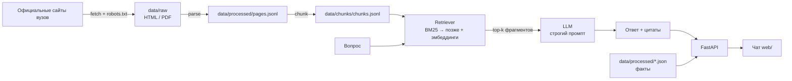

# Абитуриент-бот: вузы Новосибирска (RAG)

Репозиторий команды на хакатоне **«НЭТИ-НЕКСТ 2.0»** (20–22.11.2026).
Цель — чат-помощник на базе LLM, который отвечает на вопросы абитуриентов по вузам
Новосибирска и **ссылается на официальные источники**.

> **Статус:** рабочий скаффолд. Данные — заготовка, список вузов нужно подтвердить,
> индекс ещё не собран. Всё, что ниже, запускается без GPU.

---

## Что уже работает

- Схема данных (`src/schemas.py`) и валидатор (`scripts/check_data.py`).
- Загрузчик страниц: `httpx`, проверка `robots.txt`, кэш в `data/raw`.
- Парсер HTML → заголовок, текст, таблицы.
- Чанкование и лексический поиск (BM25-подобный, без тяжёлых зависимостей).
- Ответ с цитатами: LLM через OpenAI-совместимый API; без ключа — extractive-fallback.
- Guard от ответов «не по теме»: если значимые слова запроса не покрыты источником,
  бот честно отказывается (`grounded=false`).
- FastAPI: `/health`, `/api/universities`, `/api/chat` + OpenAPI на `/docs`.
- Минимальный чат в `web/`, отдаётся с `/`.
- Golden-set и скрипт оценки (`src/eval/run_eval.py`).

## Чего пока нет (следующие шаги)

- Эмбеддинги и векторный индекс (Chroma / Qdrant / FAISS).
- Гибридный поиск (BM25 + вектор) и реранкер.
- Структурные ответы из `programs.json` / `admission.json` (точные факты без LLM).
- Нормализация и дедупликация программ, парсинг PDF/Excel с проходными баллами.
- Деплой, мониторинг, rate limiting.

---

## Архитектура



Ключевой принцип: **сначала данные и провенанс, потом модель**. LLM не является
источником фактов — она только формулирует ответ по найденным фрагментам.

---

## Быстрый старт (Windows PowerShell)

```powershell
python -m venv .venv
.\.venv\Scripts\Activate.ps1
pip install -r requirements.txt

Copy-Item .env.example .env
# при желании впишите LLM_API_KEY, иначе будет extractive-режим

python scripts/check_data.py
uvicorn src.api.main:app --reload
```

Откройте:

- <http://localhost:8000/> — чат;
- <http://localhost:8000/docs> — OpenAPI;
- <http://localhost:8000/health> — статус и количество чанков.

Пока индекс не собран, `/api/chat` вернёт `503` с подсказкой, что запустить.

Чтобы посмотреть чат и API без сети и сбора данных:

```powershell
python scripts/make_demo_index.py
uvicorn src.api.main:app --reload
```

### Сбор данных и индекса

```powershell
# 1. Скачать страницы (пример: два вуза)
python -m src.ingestion.fetch https://www.nsu.ru/ru/ https://www.nstu.ru/

# 2. Разобрать сырьё в pages.jsonl
python -m src.ingestion.parse

# 3. Нарезать на чанки
python -m src.rag.build_chunks

# 4. Проверить качество на golden-set
python -m src.eval.run_eval
```

> Уважайте `robots.txt` и не устраивайте нагрузку: загрузчик делает паузу между
> запросами и кэширует ответы. Для хакатона достаточно одного прогона.

### Если сайт отдаёт 403

Часть вузов блокирует зарубежные IP или незнакомые User-Agent. Что делать:

1. Запустить сбор из сети вуза/с российского IP — на хакатоне вы и так там.
2. Сохранить страницу вручную из браузера в `data/raw/` и рядом положить `.meta`
   с URL (формат: строка `url: https://...`). Парсер подхватит её как обычную.
3. Использовать официальные открытые данные вуза, если они есть.

Не подделывайте User-Agent под браузер и не обходите защиту — это лишний риск
на защите проекта. Подробнее: `docs/data-sources.md`.

### Docker

```powershell
Copy-Item .env.example .env
docker compose up --build
```

---

## Структура репозитория

```
data/
  raw/<host>/...           # сырьё + .meta (url, sha256) — в git не коммитится
  processed/
    universities.json      # справочник вузов
    programs.json          # направления/специальности
    admission.json         # приём: предметы, баллы, сроки
    pages.jsonl            # результат парсинга
  chunks/chunks.jsonl      # чанки для поиска
  golden/qa.jsonl          # контрольные вопросы + эталоны
src/
  config.py                # пути и настройки из .env
  schemas.py               # Pydantic-модели данных
  ingestion/
    fetch.py               # загрузка страниц
    parse.py               # HTML -> текст/таблицы
  rag/
    build_chunks.py        # pages.jsonl -> chunks.jsonl
    retrieve.py            # BM25-подобный поиск
    answer.py              # промпт, LLM, extractive-fallback
  api/main.py              # FastAPI
  eval/run_eval.py         # оценка на golden-set
web/index.html             # минимальный чат
scripts/check_data.py      # валидация JSON
tests/                     # pytest
```

---

## Модель данных

Три сущности, связанные по `slug` и `id`:

| Сущность | Файл | Зачем |
|---|---|---|
| `University` | `universities.json` | вуз: название, сайт, контакты |
| `Program` | `programs.json` | направление: код, уровень, форма, места, стоимость |
| `Admission` | `admission.json` | приём: год, предметы, минимальные и проходные баллы, сроки |

Важные нюансы, которые нельзя смешивать:

- **Минимальный балл** — порог для участия в конкурсе.
- **Проходной балл** — фактический cutoff прошлого года (обычно по конкретному направлению).
- **Год кампании** — сейчас ноябрь 2026: приём-2026 завершён, приём-2027 ещё не стартовал.
  Любые баллы и сроки должны быть помечены годом, иначе ответы быстро «протухнут».

У каждой записи есть `sources[]`: URL, дата парсинга, период актуальности. Это нужно
и для доверия пользователя, и для защиты на хакатоне.

### Список вузов

В `data/processed/universities.json` лежат 14 вузов с `"confirmed": true`.
Список согласован; если команда решит сузиться до 12 — просто удалите лишние записи
и перепроверьте `python scripts/check_data.py`. Стратегия-хедж:
14 вузов глубоко (все программы, баллы, предметы) + остальные вузы города поверхностно.

---

## API

### `POST /api/chat`

```powershell
curl.exe -X POST http://localhost:8000/api/chat `
  -H "Content-Type: application/json" `
  -d '{\"question\": \"Какие предметы нужны на ПМИ в НГУ?\", \"top_k\": 5, \"university\": \"nsu\"}'
```

Ответ:

```json
{
  "answer": "…",
  "sources": [{"url": "https://…", "title": "…", "score": 12.3}],
  "grounded": true,
  "mode": "llm"
}
```

`mode`: `llm`, `extractive` или `extractive-fallback` (LLM недоступна).
`grounded=false` — в источниках нет ответа; модель обязана сказать об этом прямо.

### `GET /api/universities`

Список вузов из `data/processed/universities.json`.

### `GET /health`

Количество чанков и готовность индекса.

---

## Оценка качества

`data/golden/qa.jsonl` — по одному JSON на строку:

```json
{"id": "q001", "question": "…", "expected_keywords": ["…"], "expected_urls": ["https://…"], "university": "nsu"}
```

> Сейчас там **заглушка** из пяти вопросов. После сбора данных замените её на
> реальные вопросы и эталоны: 60–100 штук, включая 10–15 вопросов «вне базы».

`python -m src.eval.run_eval` считает:

- **keyword hit** — попали ли ключевые факты в ответ;
- **source hit** — сослался ли бот на ожидаемый источник;
- **no_answer** — корректно ли отказался, когда данных нет.

Пустые списки ожиданий не считаются попаданием: такие вопросы пропускаются (`n/a`).
Этого достаточно, чтобы сравнивать итерации и не деградировать. Позже можно добавить
LLM-as-judge и `ragas`, но начинать надо с простых воспроизводимых метрик.

Порог релевантности `MIN_COVERAGE` в `src/rag/answer.py` — эвристика. Подбирайте его
на golden-set: слишком высокий даёт ложные отказы, слишком низкий — ответы не по теме.

---

## План на хакатон

| Когда | Что делаем |
|---|---|
| До старта | каркас, схема, скрапер, baseline RAG, golden-set 30–50 вопросов |
| День 1 | данные, end-to-end «вопрос → ответ с цитатой», скелет UI, вечером демо |
| День 2 | гибридный поиск, структурные факты, eval-прогон, правки после чекпоинта |
| День 3 | UI, доки API, метрики, питч, подготовка к code review |

**Роли (3 человека):** data/ML (парсинг, чанки, retrieval), backend (API, оркестрация,
деплой), frontend/UX + презентация. Данные собирают все.

**Что спросить у менторов в первый день:**

1. Дадите ли контрольный набор вопросов и в каком формате ждёте ответ?
2. Оцениваются ли цитаты/источники?
3. Нужны ли все вузы или только выбранные?
4. Есть ли ограничения на внешние API и интернет во время демо?

---

## Правила и ограничения

- Только публичная информация с официальных сайтов; `robots.txt` соблюдается.
- Не собираем персональные данные абитуриентов.
- LLM не должна выдумывать числа: нет данных — нет ответа.
- Даты и баллы всегда сопровождаются годом и ссылкой на источник.

## Лицензия

Учебный проект хакатона. Перед публикацией данных проверьте условия использования
сайтов-источников.
